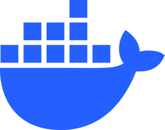
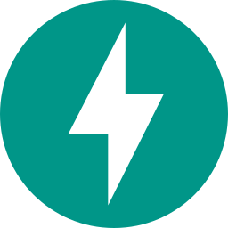

<h1 align="left" id="flaviomurata-title">:wave: Hello there! I'm Flavio Murata</h1>
<h3 align="left">I'm a Software engineer with strong cloud foundations who builds production-oriented AI systems.</h3>

  
  

- :seedling: &nbsp;I’m currently working on my **[]**
- :speech_balloon: &nbsp;I like to talk about **AI systems** and **Cloud infrastructure**
- :mailbox: &nbsp;Ask me anything on my **[issues page]**
- :computer: &nbsp;Connect with me on **[LinkedIn]**

 

<h2 align="left" id="flaviomurata-tech">Favorite Tech</h2>

> Tools, languages, and other things that I like to work with.

<table>
  <tr>
    <td align="center" width="96">
      
       Python
    </td>
    <td align="center" width="96">
      
       AWS
    </td>
    <td align="center" width="96">
      
       Docker
    </td>
    <td align="center" width="96">
      
       Kubernetes
    </td>
    <td align="center" width="96">
      
       FastAPI
    </td>
  </tr>
</table>

<!-- links -->

[issues page]: https://github.com/flaviomurata/flaviomurata/issues "flaviomurata/issues"
[linkedin]: https://www.linkedin.com/in/flaviomurata "Flavio Murata LinkedIn"
[homelab]: https://github.com/flaviomurata/homelab "flaviomurata/homelab"
